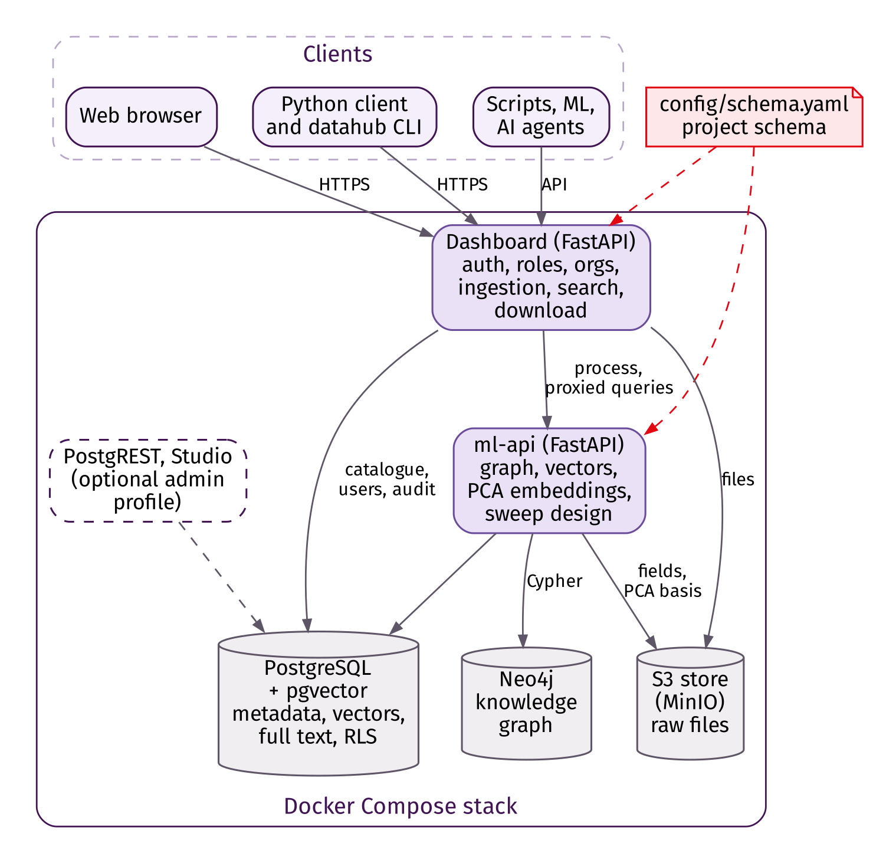

# DataHub

[](https://doi.org/10.5281/zenodo.23378345)

**A self-hosted, schema-driven catalogue for simulation and experimental data, with a knowledge graph, similarity search and parameter-sweep design.**

DataHub stores the raw files of simulation runs, experiments and reference data in an S3-compatible object store, keeps searchable metadata in PostgreSQL and links related datasets in a Neo4j knowledge graph. A web dashboard, a Python client and a command-line tool give people, scripts and AI agents the same access path, with access controlled per dataset through roles and organisations.

DataHub is generic. Everything specific to a project (dataset types, input parameters, how files are classified, which scalar results to extract, which spatial fields to compare) is described in one YAML file, the **project schema**. Each project creates its own instance and adapts the schema; no code changes are needed.

Developed at the Institute for Energy Technology (IFE), Norway. Authors: Sayan Adhikari, Gulshan Noorsumar and Øyvind Jensen.



## Features

- **Project schema** (`config/schema.yaml`): dataset types with optional parts (stages, cases, windows), typed parameters, parameter sources (JSON/YAML files, key-value files, folder names), file classes, quantities of interest (JSON keys, regular expressions, CSV column reductions), run timing, field embedding and graph rules. Validated at start-up and with `datahub check-schema`.
- **Generic catalogue**: datasets, parts, files (with SHA-256 checksums and optional time stamps) and named quantities; full-text, tag, type, status, parameter and quantity search; JSON export; ZIP download of a dataset with its metadata.
- **Three ways in**: folder drag-and-drop in the browser with a live classification preview, the Python client / `datahub` CLI, and server-side bulk ingestion for thousands of folders.
- **Knowledge graph**: datasets, parts, shared resources (for example a common mesh) and sweeps as Neo4j nodes, with `SIMILAR_PARAMS` and `SIMILAR_FIELDS` edges built automatically.
- **Similarity search**: parameter vectors built from the schema and incremental-PCA embeddings of spatial fields, both in pgvector. Field readers for VTK, NumPy, HDF5, XDMF (with HDF5 or inline data) and Exodus II, including files that hold whole time series.
- **Parameter sweeps**: coverage (extent, discrepancy, fill distance) and next-run suggestions from Sobol, Latin hypercube, random, Gaussian-process uncertainty or expected improvement, with batch diversity.
- **Access control and audit**: roles `admin` / `uploader` / `viewer`, organisations, project groups with managers, per-dataset access lists for organisations and groups, per-organisation hidden file classes, login rate limiting, session and download logs.
- **Time-limited sharing links**: give one dataset to someone without an account, with an expiry date, an optional download limit and revocation; only a hash of the token is stored and every download is logged.
- **Reproducible**: one `docker compose up`, an example schema, a synthetic demo data set and an end-to-end smoke test.

## Quick start

Requirements: Docker 24+ with Compose v2, Python 3.9+.

```bash
git clone https://github.com/MatPro-IFE/DataHub.git && cd DataHub
cp docker/.env.example docker/.env                  # replace every <CHANGE_ME>
cd docker && sudo bash setup-dirs.sh                # data folders; creates config/schema.yaml from the example
docker compose --env-file .env up -d --build
```

Open <http://localhost:8080> and log in as `admin` with `DATAHUB_ADMIN_PASSWORD`; you are asked to set a new password at first login. The **Schema** page shows the active project schema.

| Service | Host port | Purpose |
|---|---|---|
| Dashboard | 8080 | Web UI and session API (`/api/docs`) |
| S3 API / console (MinIO) | 127.0.0.1:19000 / 19001 | Object storage |
| Neo4j browser / Bolt | 127.0.0.1:7474 / 7687 | Graph administration |
| ml-api | 127.0.0.1:8090 | Graph, vectors, embeddings, sweeps (internal) |
| PostgREST, Studio (`--profile admin`) | 127.0.0.1:8001 / 3001 | Optional database administration |

All ports bind to `127.0.0.1` by default; publish the dashboard through a TLS reverse proxy (see [docs/DEPLOYMENT.md](docs/DEPLOYMENT.md)).

> **Object-store image.** The upstream `minio/minio` and `minio/mc` images were withdrawn from Docker Hub and quay.io in September 2026. DataHub defaults to the Chainguard build of MinIO and creates its bucket itself. Any S3-compatible server can be used through `MINIO_IMAGE`.

## Adapting DataHub to your project

1. Copy `config/schema.example.yaml` to `config/schema.yaml` and describe your data (see [docs/SCHEMA_GUIDE.md](docs/SCHEMA_GUIDE.md)).
2. Check it against a real folder: `datahub preview /path/to/run --schema config/schema.yaml --type simulation`.
3. Restart `dashboard` and `ml-api`.

## Try it with demo data

```bash
pip install -e ".[demo]"
python examples/make_demo_dataset.py --out demo_data      # fictitious cooling study matching the example schema
set -a; . docker/.env; set +a
python examples/smoke_test.py --data demo_data --upload-sweep
```

The smoke test uploads all demo datasets, checks classification, parameters, quantities, search, download integrity, embeddings, similarity, the graph, sweeps and organisation-based access control, and ends with `RESULT: all checks passed`.

## Python client

```python
from datahub_sdk import DataHubClient
dh = DataHubClient("http://localhost:8080", "alice", "password")
ds_id = dh.upload_folder("demo_data/simulations/run_001", dataset_type="simulation", tags=["demo"])
hits = dh.search(param="htc", op="ge", value=800)
dh.download(ds_id, "downloads/")
link = dh.share(ds_id, days=7, max_downloads=20)     # time-limited link, no account needed
```

More in [docs/API.md](docs/API.md).

## Documentation

| Document | Content |
|---|---|
| [docs/technical_report](docs/technical_report) | Technical report: design, data model, methods, evaluation |
| [docs/SCHEMA_GUIDE.md](docs/SCHEMA_GUIDE.md) | Writing and changing a project schema |
| [docs/API.md](docs/API.md) | Python client, command line and HTTP endpoints |
| [docs/DEPLOYMENT.md](docs/DEPLOYMENT.md) | Installation, configuration, backup, lifecycle |
| [SECURITY.md](SECURITY.md) | Security model, hardening checklist, reporting vulnerabilities |
| [CONTRIBUTING.md](CONTRIBUTING.md) | Reporting issues and contributing changes |

## Citation and licence

Please cite the technical report and the software (see [CITATION.cff](CITATION.cff)):

> Adhikari, S., Noorsumar, G., and Jensen, Ø. (2026). *DataHub: a self-hosted, schema-driven catalogue for simulation and experimental data with knowledge graph and parameter-sweep design*. Technical report v1.0, Institute for Energy Technology (IFE). Zenodo. https://doi.org/10.5281/zenodo.23378345

| What | Licence |
|---|---|
| Source code, configuration, scripts | [Apache License 2.0](LICENSE) |
| Technical report, figures, documentation in `docs/` | [CC BY 4.0](LICENSES/CC-BY-4.0.txt) |
| Bundled web libraries and fonts | MIT, Apache-2.0, OFL-1.1 (see [THIRD_PARTY_NOTICES.md](THIRD_PARTY_NOTICES.md)) |
| IFE name and logo | trademark, not licensed ([details](LICENSES/LicenseRef-IFE-Trademark.txt)) |

Every file carries its licence through an SPDX header or [REUSE.toml](REUSE.toml); `reuse lint` checks this in CI. The container images that DataHub starts (PostgreSQL, MinIO, Neo4j Community, optional PostgREST and Supabase Studio) are used unmodified under their own licences.
