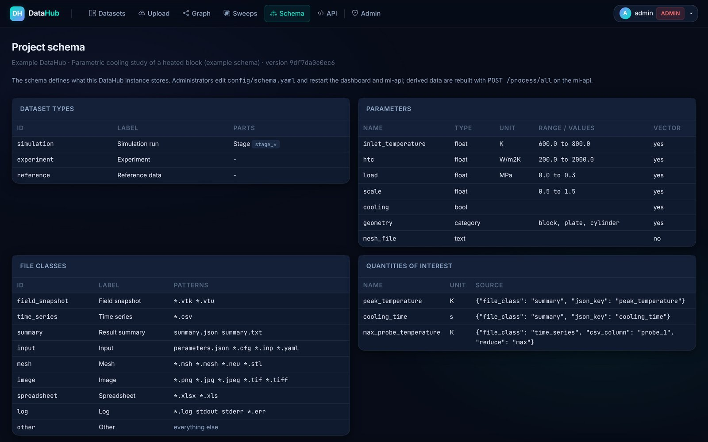
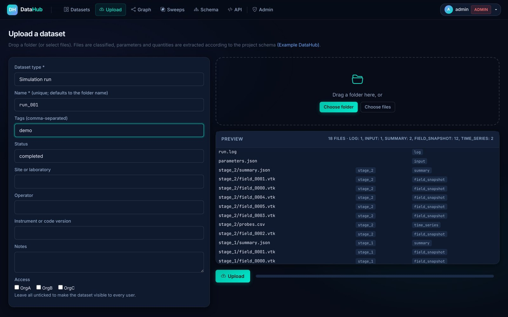
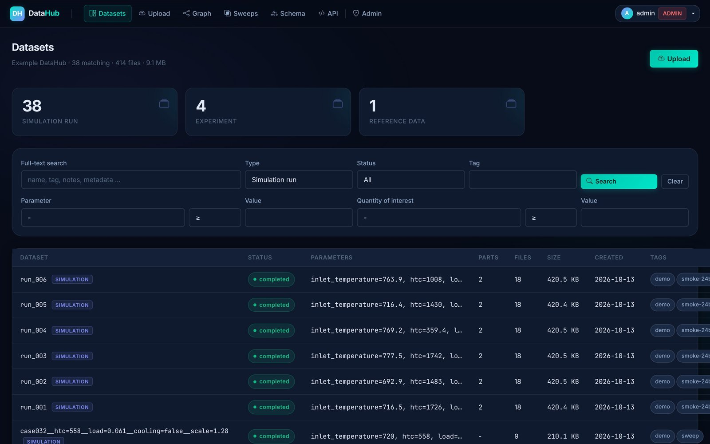
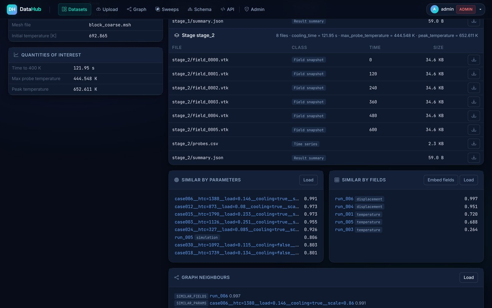
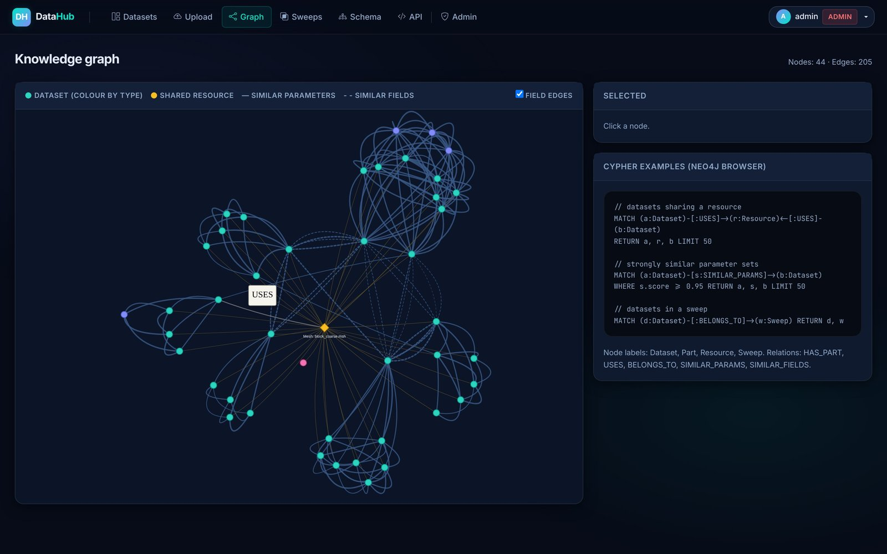
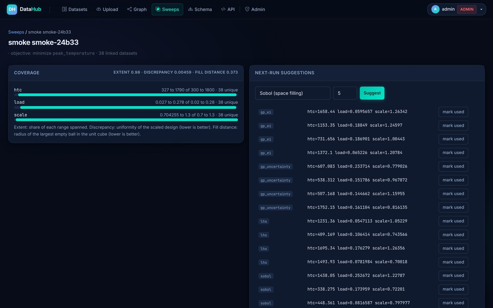
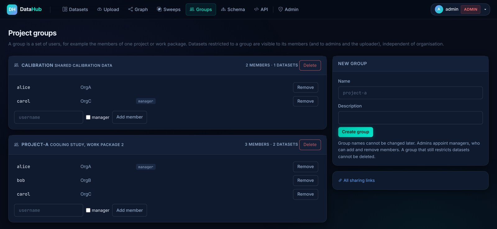
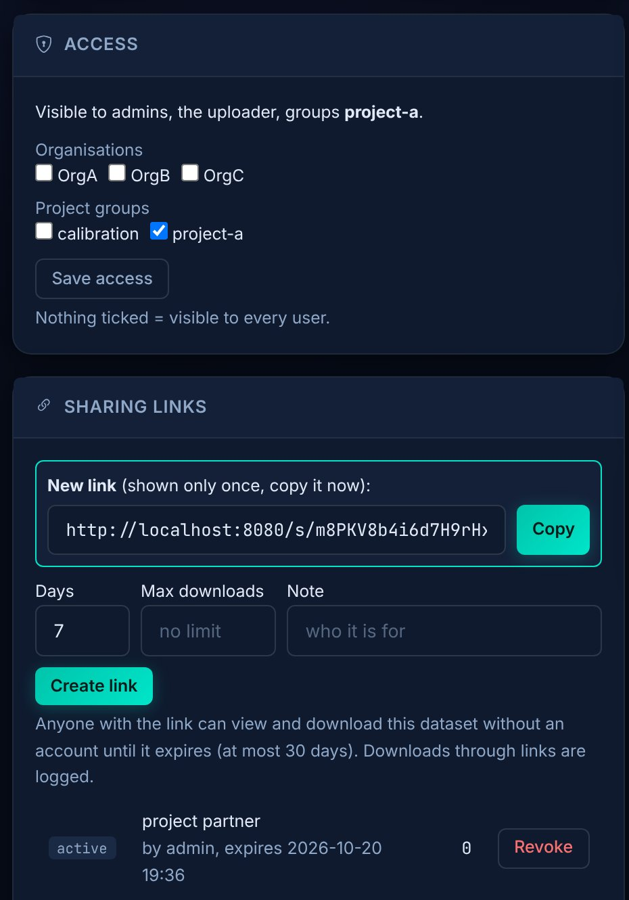
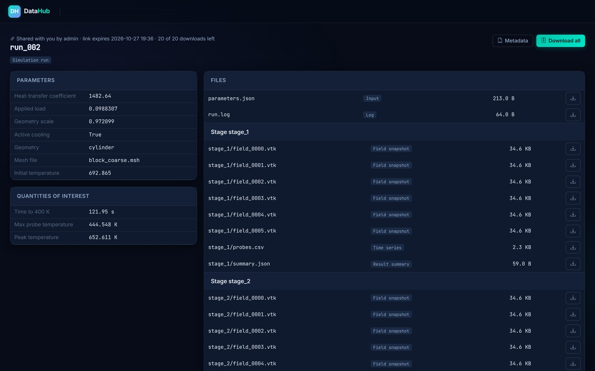

# Abstract {-}

Simulation campaigns and experimental programmes produce thousands of datasets, each a folder of heterogeneous files: inputs, meshes, spatial field snapshots, time series, summaries, images and logs. Without a catalogue these results are hard to find, compare, share across organisations and reuse for machine learning. DataHub is a self-hosted, containerised data catalogue built from open-source components. It is generic: everything specific to a project (dataset types, input parameters, file classes, scalar quantities of interest, spatial fields and graph rules) is declared in one YAML file, the project schema, so that each project runs its own instance without code changes. Raw files are kept in an S3-compatible object store; metadata, parameters, quantities and audit logs are kept in PostgreSQL with full-text and vector indexes; relations between datasets are kept in a Neo4j knowledge graph. A web dashboard, a Python client and a command-line tool give people, scripts and AI agents the same access path. Every dataset is encoded as a parameter vector derived from the schema, spatial fields read from VTK, NumPy, HDF5, XDMF or Exodus II files are embedded with incremental principal component analysis, and similar datasets are linked in the graph. A parameter-sweep module measures how well a design space is covered and proposes the next runs with space-filling or Gaussian-process designs. Access is controlled per dataset through roles, organisations and project groups; time-limited sharing links give read access to people without an account; every download is logged. A security assessment combining static analysis, dependency auditing and tests against a running instance found no critical or high-severity issues; all medium and low findings except one accepted risk were fixed, and the remaining controls are documented. This note describes the architecture, the project schema, the data model, the algorithms, the security model and the alignment with the FAIR principles, and documents a reproducible evaluation on a synthetic dataset distributed with the open-source code.

\newpage
\setcounter{tocdepth}{2}
\renewcommand{\contentsname}{\firabold\color{ifepurple}Contents}
\tableofcontents

\newpage

# Introduction

Numerical simulation has become a routine engineering tool. A study of a manufacturing process, an energy component or a material typically varies a handful of physical and numerical parameters over hundreds or thousands of runs, and each run writes a folder of heterogeneous files. Experiments that calibrate or validate those simulations add images, spreadsheets and measurement series. The same results are increasingly used beyond the original study: as training data for surrogate models and physics-informed neural networks, as reference cases for digital twins, and as context for software agents that plan new simulations. These uses place requirements on how research data is stored that a shared network drive does not meet.

DataHub was developed at IFE to meet these requirements in collaborative research projects. The design goals were:

| ID | Requirement |
|---|---|
| R1 | Keep every raw file, unchanged and retrievable, with a checksum. |
| R2 | Make datasets findable by name, tags, free text, input parameters and result quantities. |
| R3 | Capture metadata automatically at upload, from file names, folder names and output files, so that curation does not depend on manual entry. |
| R4 | Restrict access per dataset to named organisations or project groups, allow time-limited sharing with people outside the platform, and record who downloaded what. |
| R5 | Offer the same functionality to a browser, to scripts and to automated agents through documented interfaces. |
| R6 | Relate datasets to each other (shared resources, similar inputs, similar results) to support transfer learning and design of experiments. |
| R7 | Help plan new runs by showing which part of a parameter space is still empty. |
| R8 | Be adaptable to any project, solver or experiment by configuration, not by code. |
| R9 | Be deployable by a small team on a single server from open-source components, and be removable without residue at the end of a project. |
| R10 | Protect data, accounts and the host against common web, file-based and supply-chain attacks, and document the protection so that operators can verify it. |

Mature research data platforms exist, including institutional repositories, electronic lab notebooks and data lakes. They address publication or generic storage well, but none combines working-phase storage of large solver outputs, parameter-aware search, organisation-level access control and similarity-driven planning in a package that a project can configure and run itself. DataHub fills that gap. It is not a replacement for a long-term repository: cleared data is exported to one, for example Zenodo, at the end of a project.

The remainder of this note describes the architecture (Section 2), the project schema (Section 3), the data model (Section 4), ingestion (Section 5), search (Section 6), knowledge graph and similarity methods (Section 7), parameter sweeps (Section 8), access control (Section 9), cyber security (Section 10), the user interface (Section 11), FAIR alignment and lifecycle (Section 12), deployment and evaluation (Section 13), and limitations (Section 14). The code, an example schema, a synthetic demo dataset and the scripts that produce every quantitative figure in this note are openly available (Section 15).

# System overview

DataHub is a set of five containers, plus two optional administration containers, orchestrated with Docker Compose on a private network (Figure 1). Each container has one responsibility, and both application services read the same project schema.

{width=78%}

| Component | Technology | Role |
|---|---|---|
| Object store | MinIO (S3 API) | Raw files of every dataset and the persisted PCA bases. Private bucket. |
| Metadata store | PostgreSQL 15 with pgvector | Datasets, parts, files, quantities, JSONB parameters, full-text index, vectors, sweeps, users, audit logs, row-level security. |
| Knowledge graph | Neo4j 5 Community | Nodes for datasets, parts, shared resources and sweeps; similarity and membership edges. |
| Dashboard | FastAPI, Jinja2, Bootstrap | Web interface and session API: login, search, ingestion, download, graph explorer, sweeps, schema page, project groups, sharing links, user administration. 74 HTTP routes. |
| ml-api | FastAPI, NumPy, SciPy, scikit-learn, VTK, h5py | Graph synchronisation, parameter vectors, field readers and embeddings, similarity queries, sweep coverage and design. 18 HTTP routes. |
| Administration (optional) | PostgREST, Supabase Studio | Database browser and REST access for administrators, started with a Compose profile and bound to the loopback interface. |

Four design principles run through the system:

* **Configuration, not code.** Nothing in the code refers to a particular solver, file name or physical quantity. What a project stores is declared in the project schema (Section 3).
* **Files stay files.** Raw outputs are stored byte for byte under the key `datasets/<uuid>/<relative path>`. Everything derived from them (metadata, quantities, vectors, embeddings, graph edges) can be recomputed.
* **The database is the single source of truth for metadata.** The graph and the vector indexes are projections of PostgreSQL content. Losing the graph costs recomputation time, not information.
* **One access path for everyone.** The browser, the Python client, the command-line tool and agents call the same endpoints and pass the same authorisation checks.

# The project schema

A DataHub instance is configured for a project by one YAML file, `config/schema.yaml`. The repository ships an example schema for a fictitious parametric cooling study of a heated block; the parameter and quantity names used in this note (`htc`, `load`, `peak_temperature`, a `temperature` field and so on) come from that example and have no special meaning to the software. A new project copies the example, replaces the names and restarts two containers.

The schema has the following sections:

| Section | Declares | Used by |
|---|---|---|
| `dataset_types` | Kinds of dataset (for example simulation, experiment, reference) and an optional sub-level of *parts* recognised from sub-folder names (stages, load cases, time windows) | Upload form, search filters, parts |
| `parameters` | Named inputs with type (`float`, `int`, `bool`, `category`, `text`), unit, range or allowed values, and whether they enter the similarity vector | Search filters, parameter vector, sweeps |
| `parameter_sources` | Where parameter values come from, applied in order: JSON or YAML files, key-value files, regular expressions on the folder name | Ingestion |
| `file_classes` | Classes of file defined by name patterns, with optional rules that read a simulated time from the file header or the file name | Ingestion, user interface, field embeddings, access control |
| `quantities` | Scalar results of interest, read from a JSON key, a regular expression in a text file, or a reduction (`max`, `min`, `mean`, `first`, `last`) of a CSV column | Ingestion, search filters, sweep objectives |
| `timing` | Optional start and end time read from a log file | Ingestion |
| `fields` | Which file class holds spatial fields, the reader (by default chosen from the file extension: VTK, NumPy, HDF5, XDMF, Exodus II) with its options, field names, number of PCA components and snapshots | Field embeddings |
| `graph` | Parameters that identify shared resources (for example a common mesh), similarity thresholds and the number of neighbours | Knowledge graph |
| `metadata_fields` | Free-text fields offered on the upload form (for example site, operator, instrument) | Upload form, full-text search |

An excerpt of the example schema shows the style:

```yaml
dataset_types:
  - id: simulation
    label: Simulation run
    parts: {label: Stage, folder_pattern: "stage_*"}
parameters:
  - {name: htc, label: Heat-transfer coefficient, unit: W/m2K,
     type: float, range: [200, 2000]}
  - {name: cooling, type: bool}
  - {name: geometry, type: category, values: [block, plate, cylinder]}
parameter_sources:
  - {type: json_file, pattern: "parameters.json"}
  - {type: folder_name, regex: "__(?P<name>[A-Za-z]\\w*)=(?P<value>[^_]+)"}
file_classes:
  - {id: field_snapshot, patterns: ["*.vtk", "*.vtu", "*.xdmf", "*.h5", "*.exo"],
     time_regex: "TIME[^\\n]*\\n\\s*([-+0-9.eE]+)"}
  - {id: time_series, patterns: ["*.csv"]}
quantities:
  - {name: peak_temperature, unit: K,
     source: {file_class: summary, json_key: peak_temperature}}
  - {name: max_probe_temperature, unit: K,
     source: {file_class: time_series, csv_column: probe_1, reduce: max}}
```

The schema is validated when the services start and by the command `datahub check-schema`; errors name the offending key. The command `datahub preview <folder>` shows, without uploading, how a folder would be classified, which parts and parameters would be extracted and which quantities would be found, so that a schema can be tested against real data before it is deployed. Every dataset records a short hash of the schema it was ingested with, and the active schema is shown on a page of the dashboard (Figure 2).

{width=100%}

When a schema changes, derived data can be rebuilt: one ml-api call recomputes parameter vectors, graph nodes and similarity edges for all datasets. Changes to file classes or quantities apply to new uploads; older datasets are re-ingested if they should be reclassified.

# Data model

The relational model has fifteen tables (Figure 3). It is the same for every project; the schema decides what goes into it.

{width=100%}

* A **dataset** is one upload: a simulation run, an experiment, a set of reference files. It has a UUID, a unique name, a dataset type from the schema, a status, the full parameter document as JSONB, free metadata, tags, notes, two access lists (`allowed_orgs` for organisations and `allowed_groups` for project groups), optional start and end times, file count, total size and the schema hash. A trigger maintains a full-text vector over name, type, notes, tags and metadata.
* A **part** is an optional sub-level of a dataset, created when the dataset type declares a folder pattern; a two-stage simulation has two parts.
* A **file** belongs to a dataset and optionally to a part. It records the relative path, the file class, the object key, the size, the SHA-256 checksum and, where the schema says how to read it, a time value.
* A **quantity** is a named scalar result with value, unit and source, attached to a dataset or to a part. Dataset-level quantities of a multi-part dataset are taken from its last part.
* **Parameter vectors** and **field embeddings** are pgvector columns written by the ml-api (Section 7). The vector columns have no fixed dimension, because the dimension follows from the schema; queries compare only vectors of equal length and, for parameter vectors, the same hash of the parameter definitions, so that changes elsewhere in the schema do not invalidate them.
* **Sweeps**, their linked datasets and their suggestions are described in Section 8; users, project groups and their members, sharing links, sessions and download logs in Section 9.

Storing parameters as JSONB keeps the database independent of any particular parameter set while still allowing indexed queries on individual keys; values are coerced to the declared types at ingestion, so that a parameter filter compares numbers with numbers.

# Data ingestion

## Three ingestion paths

* **Browser.** A user with the uploader role drops a folder onto the upload page (Figure 4). Before anything is sent, the page asks the server to classify the file list with the schema and shows the parts and file classes that will be created. Files are then streamed in a three-phase protocol (`start`, `file` repeated, `commit`), which allows folders of any size and an abort at any time. Dataset type, tags, schema metadata fields and access restrictions are chosen in the same form.
* **Client and command line.** `DataHubClient.upload_folder()` and `datahub upload` use the same protocol over HTTPS from any machine. `datahub upload <root> --each` treats every sub-folder as one dataset, with parallel workers and `--skip-existing` for resumable batch uploads. A simulation launcher can call the client when a run finishes.
* **Server-side bulk ingestion.** For archives already on the server, `python -m dashboard.ingest <root> --each` runs inside the dashboard container against a read-only mounted folder, with a configurable number of worker threads, a progress line, an error summary and the same skip-existing behaviour.

{width=88%}

## Processing pipeline

All three paths call one function, so a dataset ingested in bulk is indistinguishable from one uploaded in the browser (Figure 5). Steps 1 to 4 run in the request; step 5 is triggered in the ml-api as soon as the dataset is registered; step 6, the field embedding, is CPU-intensive and is started on demand from the dataset page, the client or the API.

{width=62%}

If any step of 1 to 4 fails, the dataset record and all objects written so far are removed, so a failed upload leaves nothing behind and can simply be repeated.

## Throughput

Figure 6 shows the throughput of the server-side bulk tool for 128 synthetic sweep cases (1 152 files, 30 MB, generated with the demo script of Section 12) on a 2-vCPU test container that ran the whole stack. Times include container start-up of the tool, object upload, checksum, metadata registration, quantity extraction and the ml-api processing call. One worker ingested 5.4 datasets per second; four workers reached 11.5 per second, where the two CPUs saturated. On production hardware with more cores and with datasets dominated by large field files, throughput is bounded by disk and network bandwidth rather than by per-file overhead.

{width=85%}

# Search and retrieval

The search page (Figure 7) combines full-text search with filters on dataset type, status and tag, a filter on any schema parameter (equal, greater or less, with or without equality) and a filter on any schema quantity, with paging and a result table that shows the main parameters of each dataset. The same queries are available as JSON from the dashboard API, for example

```
GET /api/datasets?dataset_type=simulation&param=htc&op=ge&value=800
GET /api/datasets?quantity=peak_temperature&qop=lt&qvalue=700&tag=demo
```

and from the Python client as `dh.search(param="htc", op="ge", value=800)`.

{width=100%}

Files are downloaded one by one or as a ZIP archive of the whole dataset that includes its metadata as JSON. Both paths check access, stream the objects from the internal store and write a row to the download log. The client offers `download()`, which keeps the folder layout and can be limited to one file class, and `download_archive()`, both with the same checks.

# Knowledge graph and similarity

## Graph model

The knowledge graph makes relations between datasets explicit and queryable with Cypher (Figure 8). `HAS_PART` links a dataset to its parts; `USES` links datasets to shared resources declared in the schema (for example all runs with the same mesh file share one `Resource` node); `BELONGS_TO` records sweep membership; `SIMILAR_PARAMS` and `SIMILAR_FIELDS` record similarity with a score.

{width=82%}

Typical questions answered by the graph are: which datasets share this resource, which completed runs are closest to a planned parameter combination, and which runs of a sweep have similar result fields although their inputs differ.

## Parameter vectors

Each dataset is encoded as a vector $\mathbf{p}$ built from the schema parameters with `in_vector` set (the default for all non-text parameters):

* a numeric parameter with a declared range $[a,b]$ contributes $(x-a)/(b-a)$, so all ranged inputs lie in $[0,1]$ regardless of their units;
* a boolean contributes 0 or 1;
* a categorical parameter with $m$ allowed values contributes a one-hot block of length $m$;
* a missing value contributes 0.

The example schema gives an eight-dimensional vector (four ranged numbers, one flag and a three-valued category). The vector and its labels are stored with the schema hash in a pgvector column. Similarity between two datasets is the cosine similarity
$$ s(\mathbf{p}_i,\mathbf{p}_j)=\frac{\mathbf{p}_i\cdot\mathbf{p}_j}{\lVert\mathbf{p}_i\rVert\,\lVert\mathbf{p}_j\rVert}. $$
When a vector is stored, the nearest datasets (50 by default) are retrieved and a `SIMILAR_PARAMS` edge is written for every neighbour with $s$ at or above a threshold (0.85 by default). Both numbers are schema settings.

Figure 9 shows the similarity structure of the 32 synthetic sweep cases. The checkerboard pattern comes from the boolean and categorical dimensions: cases that share the cooling flag and the geometry are much closer than cases that differ in them, whatever their continuous inputs. Of the 496 case pairs, 73 reach the edge threshold, so the graph stays sparse and each edge is meaningful.

{width=100%}

## Field embeddings

Input similarity does not guarantee result similarity. DataHub therefore also embeds computed fields. The schema names the file class that holds field snapshots; each file is read by a field reader (Section 7.4) that returns one or more snapshots, each a set of named scalar arrays (vector and tensor fields are reduced to their norm). For a part with $T$ snapshots of a field sampled at $N$ points, the snapshot matrix $\mathbf{X}\in\mathbb{R}^{T\times N}$ is projected onto a principal-component basis $\mathbf{V}_k\in\mathbb{R}^{N\times k}$ shared by all datasets with the same field name and point count, and the embedding is the time-averaged coefficient vector
$$ \mathbf{e}=\frac{1}{T}\sum_{t=1}^{T}\mathbf{V}_k^{\top}\left(\mathbf{x}_t-\bar{\mathbf{x}}\right)\in\mathbb{R}^{k}. $$
The basis is learned incrementally (incremental PCA; Ross et al., 2008) so that it improves as datasets are added without refitting from scratch, and it is persisted in the object store. Because the first update of an incremental PCA needs at least $k$ snapshots, snapshots are buffered in the object store until that number is reached. The number of components $k$ (16 in the example) and the maximum number of snapshots per part are schema settings; longer series, for example an Exodus file with thousands of steps, are sampled evenly. `SIMILAR_FIELDS` edges are written for pairs with cosine similarity at or above a threshold (0.80 by default).

Figure 10 shows the spectrum of the `temperature` field of the synthetic sweep: two components carry 99.5 % of the variance. Real solver fields need more components, but the same rapid decay is what makes a low-dimensional embedding a useful fingerprint for retrieval.

{width=90%}

The dataset page (Figure 11) shows the parts and files of a dataset with their classes and simulated times, its parameters and quantities, the most similar datasets by parameters and by fields, and its graph neighbours. The graph explorer (Figure 12) shows the whole network; clicking a node lists its neighbours and links to the dataset page, and ready-made Cypher queries can be copied for use in the Neo4j browser.

{width=100%}

{width=100%}

## Field readers

Simulation codes write fields in many formats, and a time series is often one file rather than one file per step. The field readers form a small module of the Python package (`datahub_sdk.readers`) used by the ml-api, by the command line and by any script. With `fields.reader: auto` the reader is chosen from the file extension, so one file class may mix formats.

| Reader | Extensions | Content read | Time of a snapshot |
|---|---|---|---|
| VTK | `.vtk .vtu .vtp .vts .vtr .vti` | point and cell arrays of legacy and XML files | `TIME` field data or the file-class rule |
| NumPy | `.npy .npz` | one field per array | file-class rule |
| HDF5 | `.h5 .hdf5 .hdf` | numeric datasets, optionally selected by path patterns; optionally a leading time axis | root attribute `time`, or a time dataset |
| XDMF | `.xdmf .xmf` | node and cell attributes of uniform grids and spatial collections, with heavy data in HDF5 or inline | `Time` of each grid in a temporal collection |
| Exodus II | `.exo .e .ex2 .gen` | nodal variables, optionally element variables over all blocks; `_x`, `_y`, `_z` components combined into vector fields | `time_whole` |

Three details matter in practice. First, an XDMF file is only a description: its data live in one or more HDF5 files. The ml-api parses the XDMF file, fetches the referenced HDF5 files of the same dataset next to it, and does not read those files a second time as stand-alone HDF5 snapshots, so `*.h5` can be part of the same file class. Second, Exodus II files exist in the classic netCDF format and in the HDF5-based netCDF-4 format; the reader detects the format from the file signature and uses SciPy or h5py, so no netCDF library is needed. Third, a reader error does not stop the embedding of other files; it is reported with the file name in the response. The command `datahub fields <file>` prints what a reader finds (number of snapshots, time range, field names, sizes and value ranges) and is the quickest way to tune the `fields` section of a schema.

The readers were validated in two ways. Unit tests read files written by independent tools (h5py, the meshio library and SciPy's netCDF writer), including an XDMF time series with HDF5 heavy data, Exodus files in both netCDF formats and HDF5 files with and without a time axis. In the end-to-end test, the demo run `run_001` is written a second time as an XDMF time series with HDF5 data, as one Exodus II file per stage and as one HDF5 file per snapshot. All three are ingested and embedded through the normal pipeline; the cosine similarity of their `temperature` embeddings to the VTK original is 0.9998 (XDMF and Exodus II) and 0.9997 (HDF5), the small difference coming from the five-decimal rounding of the ASCII VTK files.

# Parameter sweeps

A *sweep* is a named design space: a set of schema parameters with ranges (pre-filled with the ranges declared in the schema) and an optional objective, a schema quantity to minimise or maximise. Datasets are linked to a sweep individually or by name pattern, and DataHub reports how well they cover the space and which runs to add next. All computations work on coordinates scaled to the unit cube $[0,1]^d$.

## Coverage

Three complementary metrics are reported. The **extent** of parameter $j$ is the share of its range spanned by the linked datasets, and the extent score is the mean over the $d$ parameters:
$$ c_j=\max_i u_{ij}-\min_i u_{ij},\qquad C=\frac{1}{d}\sum_{j=1}^{d}c_j . $$
The extent is easy to read but measures width, not uniformity: a few runs at the corners give a high score while leaving the interior empty. DataHub therefore also reports the **centred $L_2$ discrepancy** (Hickernell, 1998) of the scaled design, which measures uniformity, and the **fill distance**
$$ h=\max_{\mathbf{x}\in[0,1]^d}\ \min_i\ \lVert \mathbf{x}-\mathbf{u}_i\rVert , $$
the radius of the largest empty ball, estimated with 1 024 scrambled Sobol probe points. Figure 13 shows the difference: the extent saturates after about twenty runs for all designs, while the fill distance keeps falling and separates a good design from a poor one.

{width=100%}

## Next-run suggestions

Five methods are available.

* **Sobol**, **Latin hypercube** and **random.** A candidate set of at least 64 points is drawn from a scrambled Sobol sequence (Sobol', 1967; Owen, 1998), a Latin hypercube (McKay et al., 1979) or uniformly at random. From it, the requested number of points is chosen greedily by the maximin rule: each pick is the candidate farthest from all existing runs and earlier picks. Suggestions therefore fill the gaps of the actual design instead of repeating a fixed sequence.
* **Gaussian process, uncertainty (`gp_uncertainty`).** A Gaussian-process regressor (Rasmussen and Williams, 2006) with a constant times squared-exponential kernel plus a white-noise term is fitted to the objective quantity of the linked runs, and 1 024 Sobol candidates are scored by their predictive standard deviation. This targets where the model knows least, which suits building training sets for surrogate models.
* **Gaussian process, expected improvement (`gp_ei`).** The candidates are scored by the expected improvement over the best observed objective, which balances exploration and exploitation when the goal is to optimise the quantity.

Gaussian-process methods need an objective and at least five linked runs with a value for it; otherwise the request falls back to Sobol. A batch of Gaussian-process suggestions is formed greedily: candidates are taken in order of decreasing acquisition, and a candidate closer than 0.15 (in scaled units) to an earlier pick is skipped, so that a batch does not collapse onto one region.

Figure 14 compares the space-filling designs. With 32 points in two dimensions the random design leaves visible gaps and clusters; Latin hypercube and Sobol fill the square evenly, and the discrepancy in four dimensions confirms the faster convergence of the Sobol sequence. Figure 15 illustrates the two Gaussian-process methods on a one-dimensional example: the uncertainty method spreads its batch over the poorly sampled region, while expected improvement concentrates it near the predicted minimum.

{width=100%}

{width=100%}

All suggestions are stored with their method and score, can be marked as used and linked to the dataset that realised them, so the sweep keeps a record of how it was built (Figure 16).

{width=100%}

# Access control and audit

## Roles, organisations and project groups

Every user has one of three roles, may belong to one organisation and may be a member of any number of project groups. Organisations describe who employs a user and are a deployment setting, together with an optional mapping from e-mail domains to organisations and an optional list of file classes hidden from specific organisations. Project groups describe who works together, for example the members of one project or work package, across organisations; they are created by administrators on the Groups page (Figure 17), and each group can have managers who add and remove members.

| Role | Search and download | Upload and sweeps | Delete, change access, share | Groups | Manage users |
|---|---|---|---|---|---|
| viewer | yes | no | no | member | no |
| uploader | yes | yes | own data | member, manager | no |
| admin | yes, all data | yes | all data | create, delete, appoint managers | yes |

{width=100%}

Each dataset has two access lists, `allowed_orgs` and `allowed_groups`. When both are empty the dataset is visible to all authenticated users. Otherwise it is visible to administrators, to its uploader, to members of a listed organisation and to members of a listed group. The lists are chosen at upload and can be changed later by the uploader or an administrator on the dataset page (Figure 19) or with the client. Users can assign only groups they belong to. A group that still restricts datasets cannot be deleted, because removing it from those datasets would silently make them visible to everyone. The decision is applied on search, detail, download, archive, similarity, graph and sweep endpoints (Figure 18); results from the ml-api are filtered by the dashboard before they are returned, and the search query uses an array overlap between the dataset's groups and the user's groups so that filtering happens in the database. Hidden file classes are removed from file lists and refused on download.

{width=72%}

## Time-limited sharing links

Projects regularly need to give a dataset to someone without an account: a reviewer, a supplier, a partner outside the consortium. Creating accounts for such one-off cases is slow and leaves accounts behind. The uploader of a dataset or an administrator can instead create a sharing link (Figure 19). A link gives read access to one dataset: its parameters, quantities and file list on a public page, its metadata as JSON, and its files one by one or as a ZIP archive (Figure 21).

{width=55%}

A link is a URL containing a random token of 256 bits. Only the SHA-256 hash of the token is stored, so the URL is shown once, at creation, and cannot be recovered from the database. Every link has an expiry time, at most `DATAHUB_SHARE_MAX_DAYS` days ahead (30 by default; 0 disables links on an instance), and optionally a maximum number of downloads, where each file and each archive counts as one. The download counter is incremented by a single conditional database update, so concurrent requests cannot exceed the limit. Links can be revoked at any time by their creator, the uploader or an administrator, and administrators see all links of the instance on one page. Expired, used-up and revoked links answer with HTTP 410 (Figure 20); links are removed together with their dataset.

{width=92%}

A link never gives more than its creator could see: file classes hidden from the creator's organisation stay hidden. The public pages send `Referrer-Policy: no-referrer`, so that the token does not leak to other sites through the Referer header, and `noindex` and `no-store` headers; requests with unknown tokens are rate limited per client address. Every download through a link is written to the download log with the link identifier and its creator, so the audit trail covers people without accounts as well.

{width=100%}

## Audit

Logins are recorded with time, address and user agent, and administrators see who is online. Every file and archive download is logged with the user or the sharing link, the file, its size and the time. The log is kept in the database and survives the deletion of the downloaded data, so it documents at the end of a project who retrieved what.

# Cyber security

A DataHub instance holds unpublished research data of several organisations, is reachable over a network and parses files that users upload. This section describes the threat model, the security controls, the assessment carried out for this release and the risks that remain.

## Threat model

The assets are the raw files and their metadata, user accounts and sessions, sharing links, and the audit log. The model considers six kinds of actors: anonymous clients on the internet, holders of a sharing link, authenticated users trying to reach data of other organisations or groups, group managers, administrators, and an attacker who controls a process on the internal container network, for example through a flaw in a file parser. Figure 22 shows the trust boundaries. Everything outside the host is untrusted, including the content of uploaded files. Inside the host, the dashboard is the only component that faces users; the ml-api, the databases and the object store are reachable only from the container network and, for administrators, through SSH tunnels to loopback ports.

{width=100%}

## Security controls

The controls follow the principle of defence in depth: each threat is met by at least two independent measures.

| Threat | Controls |
|---|---|
| Password guessing and credential stuffing | bcrypt hashes; at least 12 characters by default; rate limiting per address and per user; identical response time for unknown users; temporary passwords that only allow a password change |
| Session theft and replay | `HttpOnly`, `SameSite=Lax` cookie, `Secure` and HSTS behind TLS; every cookie bound to a server-side session that logout, password change, password reset and deactivation end immediately; eight-hour lifetime |
| Cross-site request forgery, clickjacking, open redirects | SameSite cookies plus a same-origin check on all state-changing requests; framing forbidden; redirects after login limited to local paths |
| Cross-site scripting and content injection | Automatic escaping in templates and in client-side rendering; Content-Security-Policy without any third-party origin; `nosniff`; downloads always as attachments with encoded file names |
| Access to data of other organisations or groups | Access checks of Section 9 on every data endpoint; results of the ml-api filtered by the dashboard; row-level security and no rights for the anonymous database role; private bucket |
| Bypassing the dashboard from the internal network | Shared bearer token required by the ml-api; databases and the object store with their own credentials; all ports bound to loopback |
| Malicious uploaded files | Path traversal refused; size and file-count limits per upload; XML parsed with `defusedxml`; XDMF data paths confined to the dataset; derived data stored as plain arrays without `pickle`; parsers run as an unprivileged user on a read-only file system without Linux capabilities |
| Leaked sharing links | Only token hashes stored; mandatory expiry, optional download limit, revocation; `no-referrer`, `noindex`, `no-store`; tokens removed from access logs; every use logged |
| Vulnerable or compromised dependencies | No code or fonts loaded from third-party servers at run time; `bandit`, `pip-audit` and licence checks in continuous integration; weekly dependency updates proposed automatically; container images can be pinned by digest |

Configuration supports the controls: secrets are generated per instance and kept out of version control, the dashboard is published only through a TLS reverse proxy, and a hardening checklist in the repository lists the settings an operator has to make.

## Assessment

Before release the developers assessed DataHub in four steps: the threat model above; static analysis of all Python code with bandit together with a manual review of every database and graph query, template, file-path operation, deserialisation and file parser; an audit of the 39 and 52 Python packages installed in the dashboard and ml-api images with pip-audit; and dynamic tests against an instance built from the repository, including crafted XDMF files with path traversal and entity expansion.

The assessment found no critical or high-severity issue, eight medium and eleven low-severity issues. Eighteen were fixed in this release; one, the per-process memory of rate limits, was accepted and is documented. The table lists the findings; the full report with details is part of the repository (`docs/SECURITY_ASSESSMENT.md`).

| ID | Finding | Severity | Status |
|---|---|---|---|
| F1 | Open redirect after login | Medium | fixed |
| F2 | Sessions not revocable on the server | Medium | fixed |
| F3 | Forced password change not enforced on the API | Medium | fixed |
| F4 | XDMF data paths could leave the dataset folder | Medium | fixed |
| F5 | Derived data deserialised with `pickle` | Medium | fixed |
| F6 | Internal ml-api without authentication | Medium | fixed |
| F7 | Containers ran as root with full capabilities | Medium | fixed |
| F8 | Sharing-link tokens in the access log | Medium | fixed |
| F9 | API documentation public | Low | fixed |
| F10 | Session cookie without `Secure`, no HSTS | Low | fixed (configuration) |
| F11 | No upload size limit | Low | fixed |
| F12 | Unescaped file names in download headers | Low | fixed |
| F13 | Front-end assets and fonts from public CDNs | Low | fixed |
| F14 | XML parsed with the standard library | Low | fixed |
| F15 | Login time revealed existing user names | Low | fixed |
| F16 | Rate limits kept in process memory | Low | accepted |
| F17 | No security scanning of dependencies | Low | fixed |
| F18 | Minimum password length 8 | Low | fixed |
| F19 | CSRF protection by SameSite cookies only | Low | fixed |

Every fix is verified automatically: the end-to-end test (Section 13.3) contains a security section that repeats the dynamic tests, the reader tests cover path confinement and entity expansion, and continuous integration runs bandit (no remaining findings of medium or higher severity), pip-audit (no known vulnerabilities at the time of writing) and the licence check.

## Remaining risks and recommendations

* **Independent testing.** The assessment was carried out by the developers. An independent penetration test is recommended before an instance is exposed to the internet rather than to a project network.
* **Inline scripts.** The templates use inline scripts, so the Content-Security-Policy allows them. Moving all scripts to static files would allow a stricter policy.
* **Native parsers.** VTK, HDF5 and netCDF readers are large native libraries. Container hardening limits the effect of a parser flaw but does not remove it; images should be rebuilt regularly.
* **Rate limiting.** Limits for logins and invalid link tokens are kept per server process and reset at restart. Internet-facing instances should add rate limiting in the reverse proxy.
* **Trust in roles.** Group managers can grant access to their groups' datasets by adding members, and sharing links are bearer credentials. Short link lifetimes and careful appointment of managers reduce the exposure.
* **Authentication.** Accounts are local. Sign-in through an institutional identity provider and two-factor authentication are not yet available.

# User interface

The dashboard is the main entry point for people. Besides the pages shown above (search, schema, upload, dataset, graph, sweeps, groups and the public link page), it provides an API page with the interactive OpenAPI documentation, a profile page with password change, and an administration panel with user management, current sessions, the download log, the most downloaded files and all sharing links. Labels in the interface come from the schema: the upload form offers the schema's dataset types and metadata fields, the dataset page names parts and file classes as the schema does, and the search filters list the schema's parameters and quantities with their units.

The Python client (`datahub_sdk.DataHubClient`) covers the same functions for scripts and agents: login, search, metadata retrieval, upload, download, similarity, field embedding, graph neighbours, sweeps, groups, access lists and sharing links; `download_shared()` fetches a dataset through a link without an account. The `datahub` command adds schema checking, ingestion preview and reader inspection (`datahub fields`) for administrators, and `share` and `get-shared` for links.

# FAIR alignment and data lifecycle

## FAIR principles

DataHub is a working-phase platform; it supports the FAIR principles during a project and prepares data for publication in a long-term repository at the end. The table maps its features to the principles of Wilkinson et al. (2016).

| Principle | DataHub feature |
|---|---|
| F1 persistent identifiers | UUID for every dataset, part and file; DOI assigned on export to a repository and stored back on the dataset |
| F2 rich metadata | Typed parameters, quantities with units, timing, file classes, tags, notes and metadata fields, extracted at upload according to the schema |
| F3 metadata references data | Every file record holds the object key and checksum of its file |
| F4 searchable | Full-text, tag, type, status, parameter and quantity search; vector similarity search |
| A1 retrievable by standard protocol | HTTPS APIs, ZIP archives with metadata, sharing links for people without an account, S3 protocol for administrators |
| A1.2 authentication and authorisation | Roles, organisations, project groups, per-dataset access lists, time-limited sharing links, audit log |
| A2 metadata persists | Catalogue export (JSON, database dump, schema file) at the end of the project, independent of file deletion |
| I1 formal language for knowledge | Declarative project schema, JSON documents, relational model, property graph with typed relations |
| I2 vocabularies | Parameter, quantity and file-class identifiers with labels and units defined once per project in the schema |
| I3 qualified references | Graph edges for parts, shared resources, sweeps and similarity with scores |
| R1.2 provenance | Inputs, logs, uploader, timestamps and the schema version kept with each dataset |
| R1.3 community standards | Open formats (VTK, HDF5, XDMF, Exodus II, JSON, CSV, YAML); export to repositories with DataCite metadata |

## Lifecycle

A DataHub instance follows the lifecycle of the project it serves (Figure 23): a fresh instance with new secrets and a project schema is deployed at the start; data is ingested with metadata captured by the schema rules; datasets are searched, shared and used by people and agents; datasets cleared for publication are exported to a repository and the DOI is stored back; at the end, each organisation retrieves its own data (sharing links can also hand datasets to recipients without an account), the catalogue metadata and schema are exported, and storage is deleted.

{width=100%}

# Deployment, reproducibility and evaluation

## Deployment

The complete stack starts with one Compose command after secrets have been set and storage directories created; the setup script also creates `config/schema.yaml` from the example. A single server is sufficient for project-scale use: PostgreSQL holds only metadata, typically well below one percent of the object volume, and the object store grows with the raw data. Configuration is through the schema and environment variables; no code changes are needed to define the data model of a project, organisations, hidden file classes, the lifetime of sharing links, time zone, site name or the object-store image. A one-shot container applies the base database schema to an empty database and then idempotent migrations on every start, so an existing instance is upgraded by pulling a new version and restarting.

During the preparation of this release the official MinIO server and client images were withdrawn from Docker Hub and quay.io (September 2026). DataHub now defaults to a maintained third-party build of the MinIO server, creates its bucket from the dashboard instead of a separate client container, and accepts any S3-compatible server through a single variable. Health checks use only shell built-ins so that minimal images work.

## Synthetic demo data

To make the system testable without proprietary results, the repository contains a generator for a fictitious cooling study that matches the example schema. It writes

* simulation runs with two stage sub-folders, each with field snapshots in legacy VTK (a `temperature` and a `displacement` field on 315 points, with the simulated time in the header), probe time series in CSV and a JSON summary, plus a parameter file and a log with start and end times;
* sweep cases from a scrambled Sobol design whose parameters are encoded in the folder name, with a key-value file for the remaining inputs;
* experiments with a measurement CSV, an image, a summary and parameters;
* a reference dataset with a mesh file;
* the first run written again as an XDMF time series with HDF5 data, as Exodus II files and as HDF5 files, to exercise the field readers.

Fields are closed-form functions of the parameters (an exponentially cooling temperature field whose time constant depends on heat-transfer coefficient, scale and cooling, with a load-dependent hot spot and a travelling mode, plus a thermal-strain displacement field). The default set has 6 runs, 32 sweep cases, 3 experiments and one reference dataset, about 11 MB in total.

## End-to-end test

An end-to-end smoke test exercises every feature through the public HTTP interface against a fresh stack. The table lists the checks; all passed on a clean installation built from the repository on a 2-vCPU test container. The figures in this note were produced from the same instance and with the scripts in `docs/technical_note/figures/src`.

| Check | Result |
|---|---|
| Base schema and migrations applied to an empty database with stop-on-error; migrations re-applied to a running database | passed, 15 tables, idempotent |
| Administrator login, forced password change, schema served with its hash | passed |
| Upload of the demo runs, experiments and reference data through the client; bulk ingestion of 32 sweep cases | passed, 0 errors |
| Parts from sub-folders, file classes, run timing, snapshot times from file headers | passed |
| Typed parameters from JSON, key-value file and folder name | passed |
| Quantities from JSON keys and CSV column reductions | passed |
| Parameter, quantity, tag and type filters | passed |
| Downloaded file matches the stored SHA-256; ZIP archive with metadata | passed |
| Field embeddings stored (2 fields, 12 parts) | 24 |
| XDMF, Exodus II and HDF5 copies of a run: 2 fields in 2 parts each, no read errors, temperature embedding equal to the VTK original | passed, cosine at least 0.9997 |
| Parameter and field similarity queries; graph neighbours with parts and resource | non-empty, ranked |
| Sweep coverage (extent 0.98, discrepancy 0.018, fill distance 0.37) and all suggestion methods | passed |
| Viewer of another organisation gets HTTP 403 on a restricted dataset and does not find it in search | passed |
| Same viewer can open an unrestricted dataset but cannot upload | passed |
| Administrator can open the restricted dataset; deleted dataset is gone | passed |
| Group member uploads a dataset restricted to the group; a user of the same organisation outside the group gets HTTP 403 and does not find it | passed |
| Unknown group refused; group manager adds and removes a member, who gains and loses access; group still in use cannot be deleted | passed |
| Uploader widens and narrows access; outsider cannot create a link | passed |
| Sharing link opens without login with `no-referrer` and `noindex`; archive and file downloads match SHA-256; third download beyond a limit of two refused (HTTP 410); both downloads logged | passed |
| Revoked and expired links refused (HTTP 410); lifetime above the maximum refused; unknown token refused | passed |
| Security: open redirect refused; API documentation only after login; no third-party origin in the Content-Security-Policy | passed |
| Security: copied session cookie useless after logout; temporary password only allows a password change; short password refused | passed |
| Security: cross-site POST refused; ml-api refuses calls without token; path traversal in uploads refused | passed |

Preparing the public release also served as a review. It replaced solver-specific code with the schema mechanism, moved upload state from process memory to disk so that uploads work with several server workers, removed read access of the anonymous database role, made the field embedding work before the first PCA fit, computed similarity edges only after the vector existed, scaled parameter vectors by declared ranges, and replaced extent-only sweep coverage and independent Gaussian-process ranking by the metrics and batch rules of Section 8.

# Limitations and future work

* **Parameter scaling.** Numeric parameters without a declared range enter the vector unscaled and can dominate the cosine similarity. Declaring ranges is recommended; automatic scaling from observed values is a candidate improvement.
* **Re-ingestion after schema changes.** Vectors and graph edges are rebuilt with one call, but new file classes or quantities require re-ingestion of older datasets. Re-extraction from stored objects without a new upload is planned.
* **Readers.** VTK, NumPy, HDF5, XDMF and Exodus II are read. Other formats (CGNS, MED, OpenFOAM case folders, ADIOS2) need a reader, and XDMF function and hyperslab data items are not supported. All readers share one entry point, so a plug-in registry would let a project add readers without changing DataHub.
* **Field embeddings across meshes.** A PCA basis is shared only between datasets with the same point count. Interpolation to a reference grid or mesh-independent encoders would enable comparison across geometries.
* **Sweeps.** Suggestions handle continuous, integer and boolean parameters; categorical parameters are not yet part of sweep designs. Gaussian processes scale cubically with the number of runs, which is acceptable for hundreds of runs but not for tens of thousands.
* **Permissions and authentication.** Access is decided per dataset; groups have members and managers but no group-specific roles, and a sharing link covers a whole dataset. Per-file permissions, password-protected links, two-factor authentication and sign-in through an institutional identity provider (SAML or OpenID Connect) are candidates for future versions. Section 10.4 lists the remaining security risks.
* **Repository export.** Export to Zenodo is currently a documented manual procedure; an automated export with DataCite metadata is planned.

# Availability

* **Software:** DataHub version 1.0.0 under the Apache License 2.0, which allows use, modification and redistribution, also commercially, with attribution and an explicit patent licence. Source code, Compose files, example schema, demo-data generator, tests and figure scripts are published in the public repository; the software release is archived with its own DOI.
* **This note and the documentation:** Creative Commons Attribution 4.0 International (CC BY 4.0).
* **Licence information per file:** every file carries an SPDX licence identifier, either in its header or through a REUSE.toml file, and the repository passes the REUSE compliance check. The IFE name and logo are trademarks and are not covered by either licence.
* **Third-party components:** bundled web libraries and fonts (Bootstrap, Bootstrap Icons, vis-network, Swagger UI, Inter, JetBrains Mono, Fira Sans) under MIT, Apache-2.0 or the SIL Open Font License; container images (PostgreSQL with pgvector, MinIO, Neo4j Community and, optionally, PostgREST and Supabase Studio) used unmodified under their own licences; Python packages including FastAPI, NumPy, SciPy, scikit-learn, VTK and h5py. A list is part of the repository (THIRD_PARTY_NOTICES.md).

# References {-}

::: {.references}
Hickernell, F. J. (1998). A generalized discrepancy and quadrature error bound. *Mathematics of Computation*, 67(221), 299–322.

McKay, M. D., Beckman, R. J., and Conover, W. J. (1979). A comparison of three methods for selecting values of input variables in the analysis of output from a computer code. *Technometrics*, 21(2), 239–245.

Owen, A. B. (1998). Scrambling Sobol' and Niederreiter–Xing points. *Journal of Complexity*, 14(4), 466–489.

Pedregosa, F., et al. (2011). Scikit-learn: Machine learning in Python. *Journal of Machine Learning Research*, 12, 2825–2830.

Rasmussen, C. E., and Williams, C. K. I. (2006). *Gaussian Processes for Machine Learning*. MIT Press.

Ross, D. A., Lim, J., Lin, R.-S., and Yang, M.-H. (2008). Incremental learning for robust visual tracking. *International Journal of Computer Vision*, 77(1–3), 125–141.

Sobol', I. M. (1967). On the distribution of points in a cube and the approximate evaluation of integrals. *USSR Computational Mathematics and Mathematical Physics*, 7(4), 86–112.

Virtanen, P., et al. (2020). SciPy 1.0: Fundamental algorithms for scientific computing in Python. *Nature Methods*, 17, 261–272.

Wilkinson, M. D., et al. (2016). The FAIR Guiding Principles for scientific data management and stewardship. *Scientific Data*, 3, 160018.
:::
